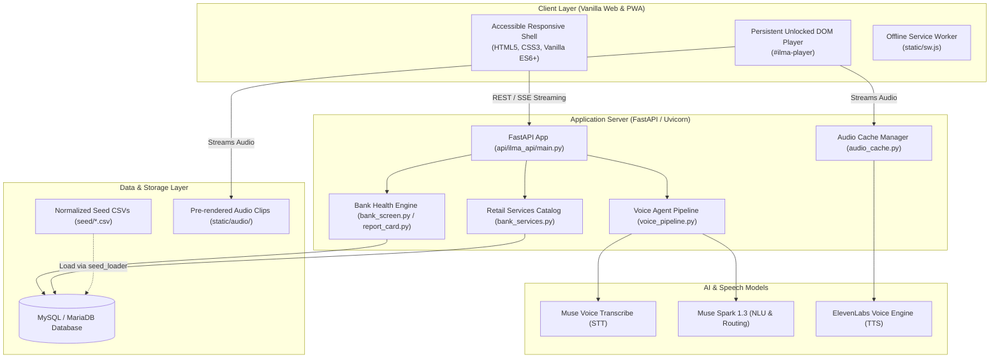

# ILMA · ইলমা

[](LICENSE)
[](https://app.sumon.me)
[](https://github.com/sjasumon/ilma/actions/workflows/checks.yml)
[](https://www.python.org/)

Say a bank's name in Bangla or English to see how that bank is doing, whether
deposits there are protected, and up to three sourced reasons. Then compare
banking services or ask a follow-up question. ILMA never asks for a PIN, account
number or amount. It gives information, not financial advice or a guarantee that
a bank is safe.

Bangla/English voice and text input, large controls, a teal-and-gold interface and
screen-reader support make banking information easier to reach, including for
blind and low-vision users.

**[Live app](https://app.sumon.me) · [Demo video](https://youtu.be/TTHuUcMNdYU)**

## Hackathon

Built for the **Meta AI hackathon, Indie track, 27 October to 4 November 2026**
(problem statement: Build for Your World).

- **Muse Voice Transcribe** (`muse-voice-transcribe-1.0`) turns spoken Bangla and
  English into text in [voice.py](api/ilma_api/voice.py).
- **Muse Spark** (`muse-spark-1.3`) understands each question in the context of the
  conversation and routes it in [voice_pipeline.py](api/ilma_api/voice_pipeline.py).
- A rules engine, not the model, decides each bank's status from published figures
  ([report_card.py](api/ilma_api/report_card.py)), and numbers are checked against
  stored facts before ILMA speaks.
- **ElevenLabs** generates spoken playback; speech synthesis is a separate provider.

Submitted version: tag
[`hackathon-submission-2026-11-04`](https://github.com/sjasumon/ilma/tree/hackathon-submission-2026-11-04)
(commit `387b100`). Later commits only tidy documentation.

## Screenshots

| Bank report | Service comparison | Source evidence |
| --- | --- | --- |
|  |  |  |

## Where the data comes from

Every number shown or spoken comes from banks' published annual reports, credit
rating releases, Bangladesh Bank press releases and circulars, news, or the
reviewed seed CSVs in `seed/`. When a figure is not published, the app says
**"অপ্রকাশিত / Not published"** instead of estimating it.

## Architecture



### Highlights
1. **Frontend (Zero-Build Philosophy)**:
   - Written in standard HTML5, CSS3, and modern Vanilla ES6+ JavaScript.
   - **No build step required**: No Node.js build pipeline, Webpack, or Vite bundling needed for deployment.
   - Asset versioning and cache-busting are handled automatically by `ops/version_assets.py` using content SHA-256 hashes.
   - Full PWA support with service worker (`static/sw.js`) providing offline shell caching.
2. **Backend**:
   - Python 3.10+ with FastAPI running under Uvicorn ASGI.
   - Database access via SQLAlchemy ORM with PyMySQL backend (MySQL for the app, SQLite for isolated unit tests).
   - High-performance fuzzy entity matching powered by `RapidFuzz`.
3. **Voice & iOS Audio Architecture**:
   - **STT**: Muse Voice Transcribe (`muse-voice-transcribe-1.0`) handles colloquial Bangla and English speech transcription.
   - **NLU**: Muse Spark (`muse-spark-1.3`) classifies intent and produces strictly grounded answers from verified project data.
   - **TTS**: ElevenLabs generates high-fidelity Bangla and English speech.
   - **iOS WebKit Audio Session**: iOS Safari blocks detached programmatic audio playback. ILMA utilizes a persistent DOM `<audio id="ilma-player">` unlocked on first user touch via `window.IlmaAudioSession.unlock(player)`. The microphone stream is explicitly released before playback to prevent iOS from locking into call-audio mode with volume suppression.

## What the app does

The interface is organized into 4 primary views accessible via the bottom dock:

### 1. Home Tab (`#tab-home`)
- **Voice Orb**: Single-tap to talk, double-tap to interrupt/stop, plus an explicit tactile Stop button.
- **Greeting Cycle**: Features a 12-state automatic greeting transition engine with bilingual accessibility labels.
- **Voice Q&A**: Real-time Server-Sent Events (SSE) streaming answers for queries like:
  - *"ইস্টার্ন ব্যাংকের অবস্থা কেমন?"* (How is Eastern Bank?)
  - *"সবচেয়ে বেশি সুদের ডিপিএস কোন ব্যাংকে?"* (Which bank offers the highest DPS rate?)
  - *"ব্র্যাক ব্যাংকের ক্রেডিট কার্ডের চার্জ কত?"* (What are BRAC Bank's credit card charges?)

### 2. Banks Tab (`#tab-detail`)
- **Sector Overview Bar (`.bank-sector-overview`)**:
  - Displays dynamic, real-time aggregate statistics from the live bank catalog:
    - Total banks monitored (11)
    - Low risk count (`✓ ৮টি ঝুঁকি কম` / `8 Low Risk`)
    - High risk count (`✕ ২টি ঝুঁকি বেশি` / `2 High Risk`)
    - Unrated count (`? ১টি মূল্যায়ন বাকি` / `1 Unrated`)
- **Segmented Filter Controls (`.bank-filter-controls`)**:
  - **Category Filter**: `All` (`সব`), `Conventional` (`বাণিজ্যিক`), `Islamic` (`ইসলামী`).
  - **Safety Filter**: `All Risk` (`সব ঝুঁকি`), `Low Risk ✓` (`ঝুঁকি কম`), `High Risk ✕` (`ঝুঁকি বেশি`).
- **Brand Monograms (`.bank-avatar`)**:
  - High-contrast visual squircle avatars (`EBL`, `BRAC`, `CITY`, `DBBL`, `ASIA`, `IBBL`, `MTB`, `NBL`, `NCC`, `PRIME`, `SBAC`).
- **3-KPI Sourced Financial Metrics Grid (`#bank-kpi-summary`)**:
  - **CRAR (মূলধন অনুপাত)**: Sourced capital adequacy percentage vs. Bangladesh Bank legal minimum of ≥10%.
  - **NPL (খেলাপি ঋণ অনুপাত)**: Sourced non-performing loans ratio vs. normal tolerance threshold of ≤5%.
  - **Deposit Protection (আমানত সুরক্ষা)**: Sourced statutory guarantee up to BDT 2,00,000 (2 Lakh) under the Deposit Protection Act.
  - *Unrated Safeguard*: SBAC Bank displays "অপ্রকাশিত / Not published" with zero hallucination.
- **Reason Cards (`#reasons-list`)**:
  - Specific audited rules (H1–H5, W1–W9, P1–P3) explaining why the bank was rated strong, watch, or high risk.
- **2-Column Quick-Action Navigation Grid (`#bank-detail-links`)**:
  - 📊 `আর্থিক অবস্থা` (Financial Health)
  - 🛡️ `রেটিং` (Credit Agency Rating)
  - 💳 `এই ব্যাংকের সেবা ও হার` (Services & Rates)
  - ⚖️ `জালিয়াতি ও মামলার ইতিহাস` (Fraud & Legal History)
  - 📰 `খবর` (News)
  - 💬 `এই ব্যাংক নিয়ে প্রশ্ন করুন` (Ask About Bank)

### 3. Bank Services Tab (`#tab-services`)
Side-by-side like-for-like retail comparisons across 11 banks:
- **Deposits (FDR & DPS)**: Rates for 3, 6, 12, 24, 36 months with client-side maturity & compound interest calculator with TIN tax adjustments (10% vs 15%).
- **Credit & Debit Cards**: Classic, Gold, Platinum, and Visa Signature tiers; annual fees, spend waiver rules, and lounge privileges.
- **Loans**: Home, Personal, and Auto loans with EMI calculators.
- **Accounts**: Savings, Current, and Special accounts with minimum initial deposit and ledger fee schedules.

### 4. News Tab (`#tab-news`)
- **Bangladesh Bank Notices & Regulatory Circulars**: Categorized by Rules, Warnings, and Press Releases.
- **Orthogonal Filtering**: Filter by category and bank independently without cross-bank contamination.
- **Per-Card Bilingual Audio Summaries**: Users can tap "Listen to News Summary" (সংবাদ সারাংশ শুনুন) on any card in Bangla or English without leaving the feed.

## Project layout

```text
ilma/
├── api/                           # Backend FastAPI application
│   └── ilma_api/
│       ├── main.py                # Primary FastAPI app routes & middleware
│       ├── db.py                  # SQLAlchemy models & database engine
│       ├── report_card.py         # Bank status evaluation & reason rules
│       ├── bank_screen.py         # Financial figure enrichment & ratings
│       ├── bank_services.py       # Retail service comparisons (cards, deposits, loans)
│       ├── voice.py               # Muse Voice Transcribe STT client
│       ├── voice_pipeline.py      # Muse Spark NLU query interpretation & routing
│       ├── audio_cache.py         # ElevenLabs audio generator & LRU cache
│       ├── seed_loader.py         # CSV seed importer
│       └── incident_loader.py     # Regulatory incident importer
├── static/                        # Frontend assets (served directly)
│   ├── index.html                 # Single-page application HTML entrypoint
│   ├── manifest.json              # Web app manifest
│   ├── sw.js                      # Service Worker with offline caching
│   ├── css/
│   │   └── ilma.css               # Unified responsive stylesheet & theme tokens
│   ├── js/
│   │   ├── app.js                 # App initialization, voice state, news audio
│   │   ├── bank-ui.js             # Banks tab: Sector overview, filters, KPI cards
│   │   ├── bank-services-ui.js    # Services facade
│   │   ├── services-ui.js         # Core services navigation
│   │   ├── deposit-ui.js          # Deposit & DPS comparisons + calculator
│   │   ├── loan-ui.js             # Loan comparisons + EMI calculator
│   │   ├── account-ui.js          # Account fees comparisons
│   │   ├── catalog-common.js      # Shared formatting, translation & helpers
│   │   ├── audio-session.js       # Persistent iOS WebKit audio unlocker
│   │   └── voice-recorder.js      # Browser microphone recording module
│   ├── audio/                     # Verified pre-rendered static audio clips
│   └── fonts/                     # Bundled Noto Sans Bengali & Tiro Bangla fonts
├── seed/                          # Normalized CSV database seeds
│   ├── institutions.csv           # 11 banks with slug, names, listed, islamic flags
│   ├── facts.csv                  # Audited financial figures (CRAR, NPL, Profit)
│   ├── ratings.csv                # Credit agency ratings (CRISL, CRAB, etc.)
│   ├── service_offers.csv         # Retail banking products & fee schedules
│   ├── news_events.csv            # Circulars and verified news headlines
│   └── incidents/                 # Approved historical incidents
├── ops/                           # Operational scripts & hygiene tools
│   ├── version_assets.py          # SHA-256 asset hasher for HTML/SW cache busting
│   └── check_repo.py              # Repository policy check & secret scanner
├── tests/                         # Node.js regression test suites & Python checks
│   ├── test_banks_upgrade.cjs     # Banks tab upgrade verification
│   ├── test_news_synchronization.cjs # News filtering & audio summary tests
│   ├── test_frontend.cjs          # DOM & runtime regression tests
│   ├── test_audio_cache.cjs       # Audio caching & LRU bounds
│   ├── test_audio_recorder.cjs    # Microphone & recording tests
│   ├── test_voice_agent.cjs       # Voice pipeline lifecycle tests
│   └── check_website_review.py    # Playwright automated browser journey tests
└── docs/                          # Specifications, audits, and design documents
```

## Run it locally

Requirements: Python 3.10+, MySQL, provider credentials and HTTPS for phone
microphones. Node.js 20+ is needed for the frontend tests. ffmpeg can come from
the system or `imageio-ffmpeg`.

```sh
git clone https://github.com/sjasumon/ilma.git
cd ilma
python3 -m venv .venv && source .venv/bin/activate
pip install -r requirements.txt -r requirements-dev.txt
cp .env.example .env    # then add your own credentials
chmod 600 .env
```

`.env` needs the database fields (`DB_HOST`, `DB_PORT`, `DB_NAME=ilma`,
`DB_USERNAME`, `DB_PASSWORD`), `META_MODEL_API_KEY`, `ELEVENLABS_API_KEY`,
`ELEVENLABS_VOICE_ID` and `VOICE_LOG_SALT`. See
[Meta configuration](docs/MUSE_VOICE_API.md).

```sh
export PYTHONPATH="$PWD/api"
python -m ilma_api.seed_loader seed
python -m ilma_api.incident_loader seed/incidents
python -m ilma_api.migrate_voice
uvicorn ilma_api.main:app --host 127.0.0.1 --port 8000
```

Open `http://127.0.0.1:8000`. See [seed notes](seed/README.md).

## Tests

```sh
PYTHONPATH=api python -m pytest -q
for f in tests/test_*.cjs; do node "$f" || exit 1; done
python ops/check_repo.py
```

The same checks, plus browser smoke tests on Android, iPhone and desktop profiles,
run in [GitHub Actions](.github/workflows/checks.yml). Repository publishing
checks are described in [REPOSITORY_POLICY.md](docs/REPOSITORY_POLICY.md).

## API

| Method | Endpoint | Description |
| :

The public site sits behind Cloudflare bot protection, which may block scripted
clients. Use a browser, or run the API locally.

## Privacy

Credentials stay server-side in the ignored `.env`. Normal audio processing
happens in memory, and operational logs leave out question text and audio.
Optional development diagnostics can keep recordings and transcripts privately
for a limited time, only when explicitly switched on. Never speak PINs, OTPs or
account numbers.

## Data provenance / prior work

Sumon performed the initial source collection **before the event** with a
separate tool that is not part of this repository. Later supplied v5.4/v6.2
exports are documented as data updates; import dates do not establish when the
collection tool was built. Only normalized seed CSVs in `seed/`
are used by the app; raw source exports and collection metadata stay outside the
current public tree. The small handwritten test fixtures are explicitly synthetic.
An earlier commit included public source-export fixtures; their removal is a new
commit, preserving the event's history rather than rewriting it.

The application code in `api/`, `static/`, `ops/` and `tests/` was developed for
this event, with the work recorded in the repository's event-dated commits. The
[FRD](docs/FRD.md) was written **before the event** and is retained as the design
document. Planning documents are not claims of completed implementation.

Imported financial/service rows keep their import version labels (v4, v5.4, v6.2);
remaining manual checks are listed in [TO_CHECK.md](seed/TO_CHECK.md). They are not described as
personally verified by Sumon. Only his completed reviews receive a checked badge.
Full newspaper articles are not published; single-source headlines are not
promoted into status-changing incidents. The official bank-insurance rule was
verified separately during the event; exclusions and payment stages are qualified.
Local theme-font copies are third-party assets under their bundled SIL Open Font
Licenses in `static/fonts/`, not newly authored font designs.

## Project documents

[FRD](docs/FRD.md) · [Build roadmap](docs/BUILD_PLAN.md) ·
[Specifications](docs/specs/) · [Design tokens](docs/tokens.css) ·
[Home reference](design/S01-Home.html) · [Voice acceptance](docs/VOICE_ACCEPTANCE.md)

Bank services v5.4 import and review notes: [implementation](docs/BANK_SERVICES_V54.md).

Extra source publications and watched-bank announcements: [v5.4 notes](docs/EXTRA_DATA_V54.md).

Optional guided Voice only mode: [tap-or-talk behavior and pending device acceptance](docs/TAP_OR_TALK.md).

Home voice-agent tools, privacy and acceptance: [VOICE_AGENT.md](docs/VOICE_AGENT.md).

## Licence and credits

Code is released under the [MIT License](LICENSE). Bundled fonts (Noto Sans,
Noto Sans Bengali, Tiro Bangla) are under the SIL Open Font License; see
`static/fonts/`. Source documents remain the property of their publishers.

Author: [@sjasumon](https://github.com/sjasumon)
