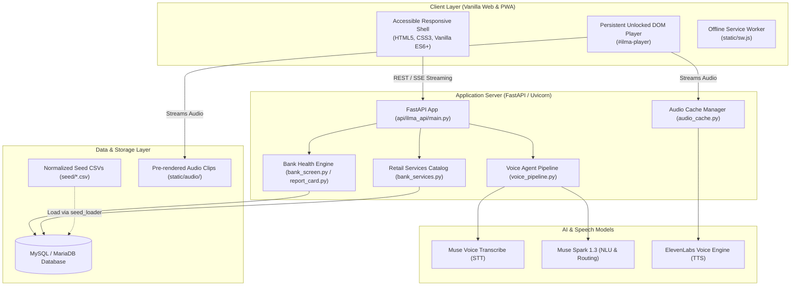

# ILMA · ইলমা
**Bilingual Voice-First Banking & Financial Intelligence Platform for Bangladesh**

[](LICENSE)
[](https://preview.sumon.me)
[](https://www.python.org/)
[](https://fastapi.tiangolo.com/)
[](tests/)

---

## 1. Executive Summary

**ILMA (ইলমা)** is a bilingual (Bangla & English) accessible financial intelligence and banking comparison platform built for everyday Bangladeshi citizens.

### Core Mission
Most consumers in Bangladesh find banking regulations, capital adequacy disclosures, loan terms, and hidden card fees intimidating or opaque. ILMA bridges this divide with:
- **Zero-barrier voice queries in natural spoken Bangla & English**.
- **Audited bank health report cards** derived directly from official annual reports and Bangladesh Bank audited metrics.
- **Side-by-side like-for-like retail product comparisons** (FDR/DPS, Credit/Debit cards, Home/Personal loans, Accounts).
- **Curated Bangladesh Bank regulatory circulars & warnings** with permanent bilingual audio summaries.
- **Inclusive, high-accessibility UI/UX**: Large readable typography, high-contrast dark teal & gold palette, screen-reader semantics, and full keyboard/touch accessibility.

> [!IMPORTANT]
> **Strict Non-Negotiable Principle: ZERO Hallucination / ZERO Invented Data**
> ILMA never invents, estimates, or hallucinates financial figures, risk classifications, or interest rates. Every single number displayed or spoken must originate strictly from audited annual reports, verified Bangladesh Bank circulars, or validated seed CSV records. Where figures are unavailable (such as unrated institutions), the UI strictly displays **"অপ্রকাশিত / Not published"**.

---

## 2. System Architecture & Tech Stack



### Architecture Highlights
1. **Frontend (Zero-Build Philosophy)**:
   - Written in standard HTML5, CSS3, and modern Vanilla ES6+ JavaScript.
   - **No build step required**: No Node.js build pipeline, Webpack, or Vite bundling needed for deployment.
   - Asset versioning and cache-busting are handled automatically by `ops/version_assets.py` using content SHA-256 hashes.
   - Full PWA support with service worker (`static/sw.js`) providing offline shell caching.
2. **Backend**:
   - Python 3.10+ with FastAPI running under Uvicorn ASGI.
   - Database access via SQLAlchemy ORM with PyMySQL backend (MySQL for preview/production, SQLite for isolated unit tests).
   - High-performance fuzzy entity matching powered by `RapidFuzz`.
3. **Voice & iOS Audio Architecture**:
   - **STT**: Muse Voice Transcribe (`muse-voice-transcribe-1.0`) handles colloquial Bangla and English speech transcription.
   - **NLU**: Muse Spark (`muse-spark-1.3`) classifies intent and produces strictly grounded answers from verified project data.
   - **TTS**: ElevenLabs generates high-fidelity Bangla and English speech.
   - **iOS WebKit Audio Session**: iOS Safari blocks detached programmatic audio playback. ILMA utilizes a persistent DOM `<audio id="ilma-player">` unlocked on first user touch via `window.IlmaAudioSession.unlock(player)`. The microphone stream is explicitly released before playback to prevent iOS from locking into call-audio mode with volume suppression.

---

## 3. Application Modules & User Journeys

The interface is organized into 4 primary views accessible via the bottom dock:

### 1. Home Tab (`#tab-home`)
- **Voice Orb**: Single-tap to talk, double-tap to interrupt/stop, plus an explicit tactile Stop button.
- **Greeting Cycle**: Features a 12-state automatic greeting transition engine with bilingual accessibility labels.
- **Voice Q&A**: Real-time Server-Sent Events (SSE) streaming answers for queries like:
  - *"ইস্টার্ন ব্যাংকের অবস্থা কেমন?"* (How is Eastern Bank?)
  - *"সবচেয়ে বেশি সুদের ডিপিএস কোন ব্যাংকে?"* (Which bank offers the highest DPS rate?)
  - *"ব্র্যাক ব্যাংকের ক্রেডিট কার্ডের চার্জ কত?"* (What are BRAC Bank's credit card charges?)

### 2. Banks Tab (`#tab-detail`)
Upgraded to an institutional fintech look & feel (Bloomberg/Morningstar style):
- **Sector Overview Bar (`.bank-sector-overview`)**:
  - Displays dynamic, real-time aggregate statistics from the live bank catalog:
    - Total banks monitored (11)
    - Low risk count (`✓ ৮টি ঝুঁকি কম` / `8 Low Risk`)
    - High risk count (`✕ ২টি ঝুঁকি বেশি` / `2 High Risk`)
    - Unrated count (`? ১টি মূল্যায়ন বাকি` / `1 Unrated`)
- **Segmented Filter Controls (`.bank-filter-controls`)**:
  - **Category Filter**: `All` (`সব`), `Conventional` (`বাণিজ্যিক`), `Islamic` (`ইসলামী`).
  - **Safety Filter**: `All Risk` (`সব ঝুঁকি`), `Low Risk ✓` (`ঝুঁকি কম`), `High Risk ✕` (`ঝুঁকি বেশি`).
- **Brand Monograms (`.bank-avatar`)**:
  - High-contrast visual squircle avatars (`EBL`, `BRAC`, `CITY`, `DBBL`, `ASIA`, `IBBL`, `MTB`, `NBL`, `NCC`, `PRIME`, `SBAC`).
- **3-KPI Sourced Financial Metrics Grid (`#bank-kpi-summary`)**:
  - **CRAR (মূলধন অনুপাত)**: Sourced capital adequacy percentage vs. Bangladesh Bank legal minimum of ≥10%.
  - **NPL (খেলাপি ঋণ অনুপাত)**: Sourced non-performing loans ratio vs. normal tolerance threshold of ≤5%.
  - **Deposit Protection (আমানত সুরক্ষা)**: Sourced statutory guarantee up to BDT 2,00,000 (2 Lakh) under the Deposit Protection Act.
  - *Unrated Safeguard*: SBAC Bank displays "অপ্রকাশিত / Not published" with zero hallucination.
- **Reason Cards (`#reasons-list`)**:
  - Specific audited rules (H1–H5, W1–W9, P1–P3) explaining why the bank was rated strong, watch, or high risk.
- **2-Column Quick-Action Navigation Grid (`#bank-detail-links`)**:
  - 📊 `আর্থিক অবস্থা` (Financial Health)
  - 🛡️ `রেটিং` (Credit Agency Rating)
  - 💳 `এই ব্যাংকের সেবা ও হার` (Services & Rates)
  - ⚖️ `জালিয়াতি ও মামলার ইতিহাস` (Fraud & Legal History)
  - 📰 `খবর` (News)
  - 💬 `এই ব্যাংক নিয়ে প্রশ্ন করুন` (Ask About Bank)

### 3. Bank Services Tab (`#tab-services`)
Side-by-side like-for-like retail comparisons across 11 banks:
- **Deposits (FDR & DPS)**: Rates for 3, 6, 12, 24, 36 months with client-side maturity & compound interest calculator with TIN tax adjustments (10% vs 15%).
- **Credit & Debit Cards**: Classic, Gold, Platinum, and Visa Signature tiers; annual fees, spend waiver rules, and lounge privileges.
- **Loans**: Home, Personal, and Auto loans with EMI calculators.
- **Accounts**: Savings, Current, and Special accounts with minimum initial deposit and ledger fee schedules.

### 4. News Tab (`#tab-news`)
- **Bangladesh Bank Notices & Regulatory Circulars**: Categorized by Rules, Warnings, and Press Releases.
- **Orthogonal Filtering**: Filter by category and bank independently without cross-bank contamination.
- **Per-Card Bilingual Audio Summaries**: Users can tap "Listen to News Summary" (সংবাদ সারাংশ শুনুন) on any card in Bangla or English without leaving the feed.

---

## 4. Directory Structure

```text
preview.sumon.me/
├── api/                           # Backend FastAPI application
│   └── ilma_api/
│       ├── main.py                # Primary FastAPI app routes & middleware
│       ├── db.py                  # SQLAlchemy models & database engine
│       ├── report_card.py         # Bank status evaluation & reason rules
│       ├── bank_screen.py         # Financial figure enrichment & ratings
│       ├── bank_services.py       # Retail service comparisons (cards, deposits, loans)
│       ├── voice.py               # Muse Voice Transcribe STT client
│       ├── voice_pipeline.py      # Muse Spark NLU query interpretation & routing
│       ├── audio_cache.py         # ElevenLabs audio generator & LRU cache
│       ├── seed_loader.py         # CSV seed importer
│       └── incident_loader.py     # Regulatory incident importer
├── static/                        # Frontend assets (served directly)
│   ├── index.html                 # Single-page application HTML entrypoint
│   ├── manifest.json              # Web app manifest
│   ├── sw.js                      # Service Worker with offline caching
│   ├── css/
│   │   └── ilma.css               # Unified responsive stylesheet & theme tokens
│   ├── js/
│   │   ├── app.js                 # App initialization, voice state, news audio
│   │   ├── bank-ui.js             # Banks tab: Sector overview, filters, KPI cards
│   │   ├── bank-services-ui.js    # Services facade
│   │   ├── services-ui.js         # Core services navigation
│   │   ├── deposit-ui.js          # Deposit & DPS comparisons + calculator
│   │   ├── loan-ui.js             # Loan comparisons + EMI calculator
│   │   ├── account-ui.js          # Account fees comparisons
│   │   ├── catalog-common.js      # Shared formatting, translation & helpers
│   │   ├── audio-session.js       # Persistent iOS WebKit audio unlocker
│   │   └── voice-recorder.js      # Browser microphone recording module
│   ├── audio/                     # Verified pre-rendered static audio clips
│   └── fonts/                     # Bundled Noto Sans Bengali & Tiro Bangla fonts
├── seed/                          # Normalized CSV database seeds
│   ├── institutions.csv           # 11 banks with slug, names, listed, islamic flags
│   ├── facts.csv                  # Audited financial figures (CRAR, NPL, Profit)
│   ├── ratings.csv                # Credit agency ratings (CRISL, CRAB, etc.)
│   ├── service_offers.csv         # Retail banking products & fee schedules
│   ├── news_events.csv            # Circulars and verified news headlines
│   └── incidents/                 # Approved historical incidents
├── ops/                           # Operational scripts & hygiene tools
│   ├── version_assets.py          # SHA-256 asset hasher for HTML/SW cache busting
│   ├── check_repo.py              # Repository policy check & secret scanner
│   └── RUNBOOK.md                 # Deployment & server maintenance runbook
├── tests/                         # Node.js regression test suites & Python checks
│   ├── test_banks_upgrade.cjs     # Banks tab upgrade verification
│   ├── test_news_synchronization.cjs # News filtering & audio summary tests
│   ├── test_frontend.cjs          # DOM & runtime regression tests
│   ├── test_audio_cache.cjs       # Audio caching & LRU bounds
│   ├── test_audio_recorder.cjs    # Microphone & recording tests
│   ├── test_voice_agent.cjs       # Voice pipeline lifecycle tests
│   └── check_website_review.py    # Playwright automated browser journey tests
└── docs/                          # Specifications, audits, and design documents
```

---

## 5. Development & Contribution Rules for Agents

When an AI agent or engineer works on this codebase, the following rules are **strictly enforced**:

### Rule 1: Zero Hallucination Policy
Never invent or estimate numbers, ratios, or quotes.
- If a figure is in `data.figures` or `data.insurance`, display it.
- If a figure is missing or `null`, render `"অপ্রকাশিত"` in Bangla or `"Not published"` in English.

### Rule 2: Preserve Critical DOM IDs & Test Invariants
Automated test suites rely on exact DOM IDs and attributes. Never remove or rename:
- `#bank-list-search` (Search input)
- `#bank-list-mic` (Voice search button; must contain `<svg>`)
- `#bank-list-rows` (Container for bank cards)
- `[data-bank="<id>"]` (Bank row button attribute)
- `#card-bank-name` (Bank title)
- `#card-status-word` (Risk status word)
- `#card-status-mark` (Risk mark check/cross)
- `#bank-kpi-summary` (3-KPI financial card container)
- `#card-insurance-line` (**Must contain `'2 lakh'` and an `<a>` link in English mode**)
- `#btn-watch-bank` (Watch button; must maintain `aria-pressed`)
- `#btn-listen-report` (Audio playback button)
- `[data-bank-detail="<key>"]` (Quick-action section navigation buttons)

> [!CAUTION]
> **English Mode Invariant (`tests/check_website_review.py`)**:
> In English mode (`currentLang === 'en'`), `[data-bank="19"]` must **NEVER** contain any `<small>` tag! Secondary titles (`<small lang="en">`) are only rendered in Bangla mode.

### Rule 3: Always Run Asset Versioning
Whenever any file in `static/` (CSS or JS) is edited, you **MUST** run:
```sh
python3 ops/version_assets.py
```
This updates the SHA-256 content hashes in `static/index.html` and `static/sw.js`. If you omit this step, client browsers and service workers will serve stale cached code.

### Rule 4: Mandatory Repository Policy Checks
Before committing or pushing, verify repository compliance:
```sh
python3 ops/check_repo.py
```
This checks:
- No unapproved brand terminology.
- No committed private secrets or unredacted keys.
- Git author identity strictly matches the approved project identity:
  `sjasumon <5217484+sjasumon@users.noreply.github.com>`

### Rule 5: Run Node.js Test Suites
Run all regression suites before publishing changes:
```sh
for f in tests/*.cjs; do echo "=== $f ==="; node "$f" || exit 1; done
```

### Rule 6: Workspace Separation
- **Preview Environment**: `/home/ubuntu/shared/all_projects/preview.sumon.me` (Port 8018, service `ilma-preview.service`).
- **Production Environment**: `/home/ubuntu/shared/all_projects/ilma` (Port 8001, service `ilma.service`).
- *Never edit or push to the production repository while working on the preview branch.*

---

## 6. Setup, Local Run & Testing

### 1. Environment Setup
```sh
cd /home/ubuntu/shared/all_projects/preview.sumon.me
python3 -m venv /home/ubuntu/venv
source /home/ubuntu/venv/bin/activate
pip install -r requirements.txt -r requirements-dev.txt
cp .env.example .env
chmod 600 .env
```

### 2. Configure Credentials in `.env`
```dotenv
DB_HOST=127.0.0.1
DB_PORT=3306
DB_NAME=ilma
DB_USERNAME=your_db_user
DB_PASSWORD='your_db_password'
META_MODEL_API_KEY=your_meta_muse_key
ELEVENLABS_API_KEY=your_elevenlabs_key
ELEVENLABS_VOICE_ID=your_voice_id
VOICE_LOG_SALT=your_private_salt
```

### 3. Database Seeding
```sh
export PYTHONPATH="$PWD/api"
python -m ilma_api.seed_loader seed
python -m ilma_api.incident_loader seed/incidents
python -m ilma_api.migrate_voice
```

### 4. Running the Development Server
```sh
export PYTHONPATH="$PWD/api"
uvicorn ilma_api.main:app --host 127.0.0.1 --port 8018 --workers 2
```

### 5. Running Tests
```sh
# Run all Node.js regression suites
for f in tests/*.cjs; do node "$f"; done

# Run Python API & logic unit tests
PYTHONPATH=api pytest tests/test_bank_screen.py tests/test_api.py

# Run Playwright browser journey checks
python3 tests/check_website_review.py --base-url http://127.0.0.1:8018
```

---

## 7. Operational Runbook & Server Commands

On the server host, the preview service is managed by systemd:

```sh
# Check preview service status
sudo systemctl status ilma-preview.service

# Restart preview service after backend changes
sudo systemctl restart ilma-preview.service

# View live systemd logs
sudo journalctl -u ilma-preview.service -f -n 50

# Verify local endpoint health
curl -s http://127.0.0.1:8018/v1/health

# Verify live preview deployment
curl -s https://preview.sumon.me/v1/health
```

---

## 8. API Quick Reference

| Method | Endpoint | Description |
| :--- | :--- | :--- |
| `GET` | `/v1/health` | Service health, database connectivity, and release metadata |
| `GET` | `/v1/institutions?list=demo` | 11 monitored banks with live computed risk status |
| `GET` | `/v1/institutions/{id}/report-card` | Bank report card with CRAR, NPL, net profit, insurance, and audited reasons |
| `GET` | `/v1/institutions/{id}/figures` | Multi-year historical audited ratios and balance sheet figures |
| `GET` | `/v1/institutions/{id}/ratings` | Credit agency ratings (CRISL, CRAB) with outlook and validity |
| `GET` | `/v1/institutions/{id}/services` | Complete schedule of deposit, card, and loan products for a bank |
| `GET` | `/v1/services/compare?category={cat}` | Cross-bank comparative tables (FDR, DPS, Cards, Loans) |
| `GET` | `/v1/news` | Bangladesh Bank circulars, regulatory notices, and press releases |
| `POST` | `/v1/voice` | Multipart audio upload for STT transcription, NLU intent resolution & streaming reply |
| `POST` | `/v1/ask` | Text-based natural language query endpoint |
| `POST` | `/v1/institutions/{id}/watch` | Anonymous device-bound watch list toggle (`X-ILMA-Device` header) |

---

## 9. Contacts & Ownership

- **Author & Maintainer**: `sjasumon <5217484+sjasumon@users.noreply.github.com>`
- **Live Preview URL**: [https://preview.sumon.me](https://preview.sumon.me)
- **Primary Git Branch**: `feature/voice-agent`
- **Release Branches**: `preview/live-2026-10-31`, `preview/merged-2026-10-31`
