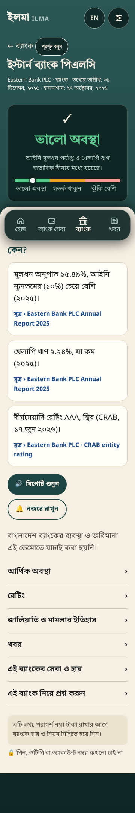
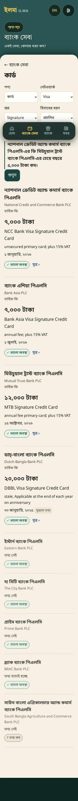
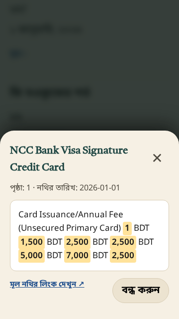

# ILMA · ইলমা

Say a bank's name in Bangla to see its financial status and up to three sourced
reasons, then compare banking services or ask a follow-up question. ILMA also
shows deposit-insurance information when a verified rule is available. It gives
information, not financial advice or a guarantee that a bank is safe.

Bangla/English voice and text input, large controls, a teal-and-gold interface and
screen-reader support make banking information easier to access, including for
blind and low-vision users.

## Hackathon

Built for the **Meta hackathon, Indie track, 27 October–4 November 2026**.

- **Muse Voice Transcribe** (`muse-voice-transcribe-1.0`) transcribes recordings
  in [voice.py](api/ilma_api/voice.py).
- **Muse Spark** (`muse-spark-1.3`) classifies questions and produces verified,
  source-grounded wording in [voice_pipeline.py](api/ilma_api/voice_pipeline.py)
  and [voice_answers.py](api/ilma_api/voice_answers.py).
- **ElevenLabs** generates spoken playback. Meta models handle transcription and
  understanding; speech synthesis is a separate provider.

[Live demo](https://app.sumon.me) · **Demo video: coming soon**

## Screenshots

| Bank report | Service comparison | Source evidence |
| --- | --- | --- |
|  |  |  |

## Demo status

- Working: nine-bank reports, sourced financial details, service comparisons,
  BN/EN transcription and questions, visible transcripts, spoken answers and
  typed recovery. Unknown or ambiguous input never defaults to EBL.
- Working: Home, Bank Services, Banks and News; EN/BN settings, optional left
  swipe, single-tap recording and double-tap stop, plus an explicit stop button.
- Working: public-report offline caching, local calculators, private Watch
  selections, API budgets, retention and local backup/restore checks.
- In progress: representative voice accuracy/latency and physical accessibility
  acceptance, native review of offline audio, financial source review, verified
  insurance input and approved incident history.
- Planned: Proof Snap image understanding/highlighting, WhatsApp voice notes and
  Watch SMS notifications. Android packaging is a decision due 1 November.

The demo is under active testing; optional diagnostic recording is currently
**enabled on the test deployment**. It must be disabled before production.
See [readiness](docs/PRODUCTION_READINESS.md),
[measured fixes](docs/RELEASE_HARDENING.md) and [roadmap](docs/BUILD_PLAN.md).

## Stack

HTML, CSS and JavaScript with a service worker; FastAPI, SQLAlchemy and PyMySQL;
MySQL; RapidFuzz; ffmpeg. No frontend build step is required. Node.js runs the
frontend regression suites. Preact/Vite and Capacitor are not implemented.

## Getting started

Requirements: Python 3.10+, an existing venv, MySQL, provider credentials and
HTTPS for phone microphones. Node.js 20+ is required for frontend tests. ffmpeg
can come from the system or `imageio-ffmpeg`.

```sh
git clone https://github.com/sjasumon/ilma.git
cd ilma
export ILMA_VENV_PATH=/path/to/your/existing/venv
"$ILMA_VENV_PATH/bin/python" -m pip install -r requirements.txt
cp .env.example .env
chmod 600 .env
```

Enter private credentials in `.env`:

```dotenv
DB_HOST=127.0.0.1
DB_PORT=3306
DB_NAME=ilma
DB_USERNAME=your_database_user
DB_PASSWORD='your_database_password'
META_MODEL_API_KEY=your_meta_key
ELEVENLABS_API_KEY=your_elevenlabs_key
ELEVENLABS_VOICE_ID=your_voice_id
VOICE_LOG_SALT=your_random_private_salt
```

Keep the documented model IDs/URLs from `.env.example`. Separate DB fields take
precedence over `DATABASE_URL`; passwords need no URL encoding. Production audio
uses Standard mode so user questions are not contributed for model training.
See [Meta configuration and source links](docs/MUSE_VOICE_API.md).

Provision **ilma**, then import the normalized seed CSVs:

```sh
export PYTHONPATH="$PWD/api"
"$ILMA_VENV_PATH/bin/python" -m ilma_api.seed_loader seed
"$ILMA_VENV_PATH/bin/python" -m ilma_api.migrate_voice
"$ILMA_VENV_PATH/bin/python" -m ilma_api.voice_doctor --live
"$ILMA_VENV_PATH/bin/uvicorn" ilma_api.main:app --host 127.0.0.1 --port 8001
```

Open `http://localhost:8001`; API documentation is at `/docs`. The readiness
command contacts providers and exits nonzero while acceptance gates remain.
The loader rejects unrelated MySQL databases. See [seed notes](seed/README.md).
Host-specific services, private backups and deployment commands belong in
[the operations runbook](ops/RUNBOOK.md).

## API overview

| Endpoint | Purpose |
| --- | --- |
| `GET /v1/health` | Database/release health |
| `GET /v1/institutions?list=demo` | Nine banks and computed status |
| `GET /v1/institutions/index` | Names and aliases |
| `GET /v1/institutions/{id}/report-card` | Sourced bank report |
| `GET /v1/institutions/{id}/figures`, `/ratings`, `/events` | Bank details |
| `GET /v1/news` | Linked headlines, labelled by verification state |
| `GET /v1/services/categories`, `/compare` | Like-for-like services |
| `GET /v1/institutions/{id}/services` | Visible bank offers |
| `GET /v1/services/offers/{offer_id}` | Source-backed product attributes |
| `POST /v1/voice`, `/v1/ask` | Audio/text with SSE transcript and answer |
| `POST /v1/speech`, `/v1/services/readout` | Spoken readouts |

## Tests and repository checks

Install **development** dependencies and run pytest; unittest discovery alone
omits function-based tests:

```sh
"$ILMA_VENV_PATH/bin/python" -m pip install -r requirements-dev.txt
PYTHONPATH=api "$ILMA_VENV_PATH/bin/python" -m pytest -q
node tests/test_frontend.cjs
node tests/test_greeting_cycle.cjs
node tests/test_voice_search.cjs
node tests/test_audio_recorder.cjs
node tests/test_offline.cjs
python3 ops/check_repo.py
```

Use the pinned Gitleaks installer and versioned pre-push hook as described in
[repository checks](docs/REPOSITORY_POLICY.md). The hook checks history and runs a
full-history redacted secrets scan before publishing. SQLite is used only in
isolated tests. Provider mocks do not establish real speech accuracy.

## Privacy

Credentials remain server-side in the ignored `.env`. Normal audio processing
uses memory; operational logs omit question text and audio. Optional development
diagnostics retain recordings/transcripts privately in MySQL for investigation,
under explicit switches and retention. This mode is currently active for testing.
Never speak PINs, OTPs or account numbers. No private recordings, diagnostic
exports, backups or generated review drafts are committed.

## Data provenance / prior work

Sumon collected the source data **before the event** with a separate collection
tool that is not part of this repository. Only normalized seed CSVs in `seed/`
are used by the app; raw source exports and collection metadata stay outside the
current public tree. The small handwritten test fixtures are explicitly synthetic.
An earlier commit included public source-export fixtures; their removal is a new
commit, preserving the event's history rather than rewriting it.

The application code in `api/`, `static/`, `ops/` and `tests/` was developed for
this event, with the work recorded in the repository's event-dated commits. The
[FRD](docs/FRD.md) was written **before the event** and is retained as the design
document. Planning documents are not claims of completed implementation.

Imported financial/service rows remain labelled `agent-v4`/`agent-v5`; manual
checks are pending in [TO_CHECK.md](seed/TO_CHECK.md). They are not described as
personally verified by Sumon. Only his completed reviews receive a checked badge.
Full newspaper articles are not published; single-source headlines are not
promoted into status-changing incidents. Insurance remains unavailable without
an official source.

## Project documents

[FRD](docs/FRD.md) · [Build roadmap](docs/BUILD_PLAN.md) ·
[Specifications](docs/specs/) · [Design tokens](docs/tokens.css) ·
[Home reference](design/S01-Home.html) · [Voice acceptance](docs/VOICE_ACCEPTANCE.md)
